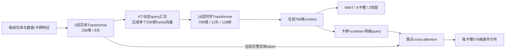

# 当前 BC 架构与平台期诊断（2026-11-10）

## 判断

现有证据不能把epoch5–7验证平台归因于容量不足。当前122,621,959参数模型的主要参数位于时序主干；优先应区分时机监督/数据保真度/优化噪声与表示瓶颈，不建议直接扩到300M或同时重写多个模块。

本次依据当前实际训练源码`.tmp_latest`、已下载的最终epoch7审计JSON，以及此前FP16故障日志；没有重新启动收费实例，没有修改模型或训练参数。

## 实际结构

生产预设来自`.tmp_latest/configs/model.yaml:43`，训练恢复校验会比较完整ModelConfig（train_bc.py:530附近）；V2/readout2、dynamic4、FP32帧编码器/落点头已在运行报告中记录。

- 128帧×0.25秒约为32秒过去信息，**不等于只能优化未来32秒的收益**。
- 时序层参数按PyTorch TransformerEncoderLayer计算约113.4M，占总量约92.5%。增加时序宽度/层数并不直接解决输入汇总或落点读出的问题。
- dynamic4把4个汇总query投影为一个256维向量：WAIT/选牌依赖这一表示，存在压缩瓶颈的可能。当前落点头直接读取当前全实体token，不能说空间细节都丢了。
- WAIT是线性logit头，但其输入已经经过深层非线性网络；单凭头是线性层，不能判定表达力不足。
- 最终分布是7类动作类型/卡槽softmax与条件576格softmax组合，不是2307动作完全平铺竞争。不能将PPO联合熵的历史讨论当成本轮BC停滞原因。
- readout2新增的空间FiLM残差门约0.0095，仅说明新分支启用较弱；原tile queries、残差和实体cross-attention仍存在。没有证据支持“空间头完全不工作”或“LayerNorm锁死上限”。

## 什么确实没有继续改善

同1024行验证集，epoch5→7：综合分6.8640→6.8928（越低越好），时机NLL0.8303→0.9039，选牌准确43.33%→45.21%，真值卡槽下落点准确6.875%→7.708%。内容读出略有改善，时机却没有稳定改善。

自然验证4096行上，动作标签行的非WAIT概率25.21%→31.99%→21.38%，WAIT标签行16.37%→20.83%→13.69%，呈整体出牌倾向波动。尚未测choice状态上的排序可分性，不能判定网络根本分不出应出牌和应等待。

当前是BC，loss不使用value输出、GAE或环境reward。Critic与奖励信用分配不是本次平台的直接解释。BC也不直接优化实战胜率，离线标签指标与对战强度必须分别验证。

## 更优先的解释与检查

### 1. 监督密度、时机权重与标签保真度

175训练局只有11248个独立出牌标签和504个技能标签。492000总帧包含验证/留出局及大量相邻WAIT，不能当作492000个独立战术示范。

每epoch抽样约一半非WAIT，但timing目标先验0.20使非WAIT权重约0.4、WAIT权重约1.6（bc.py:89–104）；这是名义上1:4的时机类权重，不是强制策略每局20%时间出牌。模型对不易区分的状态偏WAIT与这个目标相容。条件选牌和落点仍单独监督，没有被0.20一并缩小。

所有合法WAIT都可能被抽样，未单独排除forced WAIT；只有WAIT合法的状态，其时机loss天然为0、没有决策梯度。应在choice状态上重新衡量动作/等待比例及可分性。

当前数据来自repaired_live_capture：修复后的状态与实际执行动作对应，但不是已经核验的人类原局状态。手牌、时刻或落点修复后，原人类动作未必仍有原战术含义。应按修复强度分层，不应把合法执行率视为策略监督保真度，也不应未经审计宣布全部数据无效。

### 2. 输入尺度已有具体异常线索

`.tmp_l4/fp16_diagnose.log`记录真实frame.entity_in输入最大值99999.984375，导致FP16前向溢出；当前用FP32帧编码器避免溢出。

已核实一条量级精确吻合的来源路径：

1. `.cache/replay-viewer/tables/16.635.3/actions.json:3505–3512`的add_forever_invisibility对RageBarbarianEvoGhostForeverInvisibleBuff设置SpawnTime=999999999毫秒。
2. `.tmp_crforge/core/src/main/java/org/crforge/core/battle/data/ActionRows.java:2290`将SpawnTime传给SpawnBuff；`battle/action/SpawnBuff.java:87`把spawnTimeMs传给spawnBuff。
3. `.tmp_crforge/env/src/main/java/org/crforge/env/LadderEnv.java:2255`将BuffInstance.getRemaining()直接写入buff_ms。
4. `.tmp_latest/src/cr_rl/data/observations.py:135–137`只对buff_ms除以10000，没有永久时长的特殊编码或范围控制。

数值复算：float32( float32(999999999 - 150) / 10000 ) = 99999.984375，恰好吻合故障日志最大值。这证明代码/表中确有能产生此极值的路径；尚未逐字段读取原失败训练batch，因此不能宣布具体字段命中或已经证明平台期根因。代码的真正永久哨兵是BuffInstance.FOREVER=-1，不是1e9；这里是游戏表以超大有限时长表达近似永久。

后续还需统计该字段在实际训练集的频率、与梯度尖峰的对应，以及语义保持的时长编码是否改善小集拟合与验证。可考虑把正常时长、超长/永久状态分开编码，或审慎采用对数时长；这会改变输入表示，应通过显式迁移/独立分支验证，不应直接热更旧checkpoint输入。

FP32能保证范围，不保证极端输入不会影响优化条件。输入尺度可能与梯度尖峰有关，但现在没有足够证据证明这条因果链。正确做法是逐字段统计分位数/极值、未知值和哨兵含义，再做语义保持的编码对照；不应盲目全局clip或直接归零。

### 3. 梯度累积不是精确的96行条件目标

bc.py:105/140在每个microbatch4内分别按非WAIT数/出牌数求均值，train_bc.py再平均24次。这与把96行拼在一起、按总非WAIT数/出牌数归一化不同。

例：一个只含1个出牌的微批次与一个含4个出牌的微批次对落点loss贡献被等权平均，导致逐出牌样本权重不同。它不一定使算法无效，但引入组成依赖；直接换microbatch也会改变梯度。应先记录有效组计数，做正确累积分母与当前实现的固定批次梯度对照。

BC会全局clip到1.0。已记录裁剪前梯度最高726.44，说明部分更新受到强裁剪；没有非有限更新/溢出跳步。Adam有动量和自适应缩放，不能把clip比例直接解释成学习率同比下降。

### 4. 原始loss的绝对值不证明容量不足

训练使用conditional objective、timing prior0.20和sigma1.0高斯落点软标签；验证的joint/hard-label loss以及另算的条件综合分并非同一公式。

软目标交叉熵最优值为目标熵而非0。二维内部sigma1高斯离散目标熵约2.8 nats，边界/合法格截断会改变此下界。因此train loss≈6、落点loss≈4.49不能独立证明模型拟合不了，也不能用当前train/val数字直接判断过拟合差距；应同时记录硬标签NLL和超出目标熵的KL项。

## 最少成本的区分实验

先不购买更大模型/第二台GPU，诊断顺序如下：

1. 从本地数据抽少量有真实选择的状态，统计每字段分布、完全相同输入的冲突标签、forced/choice WAIT，以及修复程度；保持原文件不可变。
2. 固定64–128个真实状态（包括choice WAIT和动作，先排除完全相同输入的标签矛盾），做小集拟合探针。同时记同口径timing/conditional-card/hard-tile NLL、准确率、梯度分组和裁剪率。sigma1时不要求loss→0。
3. 若小集能明显拟合而留出集不升：优先扩大/清理监督数据及改善时机标签，支持泛化/数据限制，不支持先加容量。
4. 若小集也拟合不动：先定位输入尺度、梯度/优化和动作读出；用冻结主干只训头与全量更新作对照。拟合失败本身还不能直接判定容量不足。
5. 只有在数据与优化检查通过后，才做结构消融：让时机/选牌头额外读取当前实体或保留多个frame token，或用同协议小模型对照。每次只改一项，以验证/实战收益决定是否保留。

直接把16层768维主干换成24层1024维，会增加计算和成本，现有证据不足以支持这一改动。
