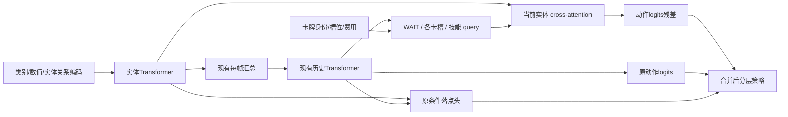

# 实体时序策略的架构选择与改造顺序（2026-11-10）

## 建议

可以修改架构。当前最值得实现的第一版是：**版本化的语义输入编码 + 当前实体Transformer + 历史context + 动作query对当前实体的直接读取 + 原分层落点头**。先保留现有主干，让一次受控实验回答“时机/选牌是否受单256维frame汇总限制”。

若随后需要重做序列核心，优先比较较浅Transformer、GRU/LSTM基线及GTrXL记忆核心。Mamba/SSM保留作研究候选，不在128帧短窗和当前监督规模上预设其更强或更快。

这是架构建议，不是已完成的模型升级。此次只做代码/资料研究，没有启动训练或改变生产checkpoint。

## 与本项目直接相关的证据

- 当前122.6M参数约92.5%在16层768维时序Transformer；实体4层256维，dynamic4 query汇总后又投影为单个256维frame。
- 时机/卡槽决策主要通过这个frame→history context路径读棋盘。落点头则已直接cross-attend当前实体token，所以需要加强的是前者，而非重复给tile头添加同类能力。
- 128帧约32秒过去信息；它限制可直接读取的历史，不等于未来信用分配视野。
- 当前incremental_frames.py/frame_cache.py只缓存实体帧特征，时序窗口仍完整重算。模型的learned absolute position随窗口位置重编号，不能简单接普通KV缓存并保证原输出不变。
- 真实64状态小集能改善，而64控制状态整体退步；类别编码遗漏和超长时长输入已核实。更大的主干不会自动恢复错误或缺少的语义。

## 候选结构比较

| 结构 | 对本项目的价值 | 主要成本/边界 | 优先级 |
|---|---|---|---|
| 当前Transformer + 动作query实体读出 | 直接改善WAIT/选牌读取当前空间细节的路径；可保留旧权重 | 需显式新readout版本、初始输出parity、单因素对照 | 最高 |
| 多latent实体汇总 + 分解时空注意力 | 每帧保留多个空间摘要，减少单向量瓶颈 | 训练与缓存变更；不能把4×128 token朴素展平后期待免费提速 | 中期 |
| 4–8层、384–512维的较小Transformer | 作为相同输入/目标下的容量与吞吐基线 | 较小不等于必然更强，旧主干不能直接等价换形状 | 对照用 |
| 1–2层GRU/LSTM、256–512维 | 持续隐状态、低成本逐步推理，适合4Hz在线控制基线 | 需要连续chunk训练、burn-in、reset、hidden重建；不能沿用随机单行且没有记忆的训练方法 | 速度/记忆基线 |
| Transformer-XL/GTrXL | 跨片段记忆；GTrXL门控有RL稳定性研究依据 | 改动训练/采样/old_logp重算；不同任务结果不能直接迁移为本项目保证 | 确认记忆需求后优先 |
| Mamba/SSM或Attention-SSM混合 | 长序列流式状态、选择性记忆值得研究 | 当前128帧未证明注意力平方项主导；Windows/V100/FP16内核和部署需实测 | 后置 |

## 第一版：新增实体到动作的读取路径

query由历史context、相应卡牌/槽位embedding及合法的语义数值构造。每个query学习“与这个动作有关的实体与空间关系”，关系权重由BC/PPO梯度学习。可以使用约7个query（WAIT、4卡槽、2技能），不需要手工指定哪些牌/单位应被优先保护。

采用新的cross-attention读出，以零初始化的最后输出投影产生logit残差，迁移起点保持原策略。不要同时零初始化门和最后投影而把整个新增分支关死。初始前向应以同精度明确容差核对，逐项保留旧tensor不等于所有GPU/精度输出逐bit相同。

该新增分支用约7个query读取当前实体，现有tile头使用4×576个query。结构上新增计算较少，但这是复杂度判断，实际耗时与内核效率必须benchmark，不能承诺强度/速度提升。

## 表示升级要先分清语义

- queue、enemy_play_cast：接共享词表embedding，保留队列/事件槽位顺序。
- ability_unit：是实体handle，使用可观察实体匹配或presence关系，不能当作卡牌ID；其他目标handle同样处理。
- buff时长：区分未知、正常有限、超长/永久状态，采用有界或对数时长；不能把所有-1随意等同于0。
- 相对几何：可给attention加入可学习Δx/Δy/距离/敌我或目标关系偏置。当前已拥有绝对坐标/Fourier/目标坐标，因此这是改善归纳偏置，不是补全“完全缺失的坐标”。
- 公开卡牌机制特征（费用、类别、射程、飞行、目标类型、半径等）可辅助共享跨卡规律，需准确区分形态/等级。先做身份/时长修正，不同时增加一整套未审计特征。

表示升级会影响旧输入路径，必须显式版本化。在新旧表示之间是否保留权重、哪些新增参数零初始化/重新学习、optimizer moment如何迁移，都应单独记录。不要把新adapter直接套旧checkpoint后宣称是同策略续训。

## 第二版：保留多个latent，但避免朴素增大序列

当前dynamic4已经计算4个query，但随后flatten/project回单个256维frame。可尝试保留4个latent的身份，在latent内做跨帧时序，再在帧内做latent交互，最终动作query读取它们。也可以先用少量latent做跨时刻的cross-attention压缩。

如果将4个token×128帧直接拼成512token并使用原16层768维网络，在相同宽度/层数下FFN工作量约4倍、注意力score矩阵约16倍。把200实体×128帧全部展平更不适合当前预算。应使用分解时空注意力或固定数量latent，而非盲目加长全注意力序列。

## 第三版：持续记忆与seq训练

GRU/LSTM、GTrXL或SSM的共同价值是持续处理新帧，避免每个决策把整个128帧窗口从头运行。但这不是只替换nn.Module：

1. 数据按连续座位/对局chunk采样，包含时间mask、边界及必要burn-in；截断反向不应被误称为无限长梯度。
2. 每个环境/座位保留独立状态，episode reset不串记忆，评估与采样状态一致。
3. PPO更新时记录或重建该采样策略的初始状态；权重更新后处理stale memory，优化重算old_logp需与采样保持一致。
4. 位置编码与memory缓存共同设计。当前滑窗learned absolute position不能直接拿来做无损流式KV缓存。
5. 使用同输入、同标签数、同有效batch/预算比较吞吐、分头验证和实战，不能只比单个token延迟。

若确需新序列主干，可将GTrXL的4–8层、512维作为一个待测配置，并用1–2层GRU/LSTM作简洁基线。具体参数量与性能在实现后统计，原论文未验证本项目的卡牌策略、V100吞吐或FP16边界。

## 实验顺序与验收

1. 原表示/原结构保留为A。
2. 只修语义输入编码作为B，先做固定小集/控制集，再做完整验证。
3. 在选定输入版本上只加动作query读出作为C，核对初始parity、梯度、参数/显存/吞吐。
4. 若B/C仍受历史表示限制，再比较多latent或较小/循环主干，明确是否重训/蒸馏。
5. 所有候选以同一批完整验证与固定换边实战选择，超参数搜索集与最终留出集分开。小集更会记忆或16局9–7都不足以自动晋升。

输入修正与架构增加不应混在一个无法归因的首轮实验里。也不应同时变reward、GAE、LR和主干，使得提升来源无法判断。

## 原始资料与适用边界

- [GTrXL: Stabilizing Transformers for Reinforcement Learning](https://arxiv.org/abs/1910.06764)：在部分可观察RL基准研究门控/Transformer-XL的优化稳定性；支持将其纳入记忆核心候选，不证明本项目必然优于当前Transformer。
- [Transformer-XL](https://arxiv.org/abs/1901.02860)：片段循环记忆与相对位置方案。语言模型的长上下文/推理加速数字不用于估算本项目。
- [Perceiver IO](https://arxiv.org/abs/2107.14795)：以latent和输出query处理结构化输入输出，也包含StarCraft II实验；支持实体latent/action-query设计思路，但本方案不是照搬其已验证配置。
- [Mamba](https://arxiv.org/abs/2312.00752)：选择性状态空间与长序列/循环推理；原论文的长序列吞吐倍率不能搬到4Hz×128帧游戏输入。
- [AlphaStar原论文](https://www.nature.com/articles/s41586-019-1724-z)：复杂实时游戏中人类示范与多智能体强化学习的实践参考。本次成功读取摘要和补充资料定位说明，详细架构zip超过此次2MB下载上限未保留；不将未读的细节作为确定实现依据。

论文页面于2026-11-10读取，文本缓存位于G盘artifacts/bc_diagnostic_20261110/research。没有把任何论文中的收益当成本项目实测。
