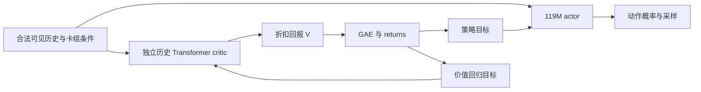

# BC 数据与 PPO critic 审查（2026-11-03）

后续实现：[独立 critic](INDEPENDENT_CRITIC.md)已接入新的 PPO 训练路径。
本文保留改造前的审查结论；下方“设计、尚未接入”的文字描述的是审查时的状态。

## 已核实的训练规模

依据 `artifacts/bc_multideck_20261103/data_sufficiency.json`、
`bc_selection_full.json`、`ppo_metrics.jsonl`，本轮是流程验收规模，不能据此宣称通用对战能力。

| 项目 | 实际数量 |
|---|---:|
| 重建人类对局 | 40 场 |
| 全部帧记录 / 有效动作标签 | 65,854 / 65,814 |
| 全部合法出牌标签 | 2,495 |
| BC 训练对局 / 帧 / 出牌 | 25 / 40,091 / 1,440 |
| BC 验证对局 / 出牌 | 7 / 352 |
| 卡组隔离而排除的对局 | 8 |
| BC 抽样次数 / 优化器更新 | 8,192 / 512 |
| PPO 采样 / 完结对局 / 优化器更新 | 9,216 / 10 / 12 |

帧高度相关，绝大多数标签为 WAIT；抽样次数、滑动历史窗口与重复 epoch 都不会创造新的独立人类决策。
卡组配置数量也不等于每个卡组已获得足够训练覆盖。
当前未提供技能动作的 BC 监督。重建对局存在版本、等级映射和事件执行偏差；增加原始记录数量前仍需做质量过滤。

验证使用全部 352 个有效出牌标签与固定 1,024 个 WAIT 标签；下列结果不能解释成对战胜率：

| 验证指标 | 初始化基线 | 选中的第 4 epoch |
|---|---:|---:|
| 给定出牌时的手牌槽位准确率 | 30.40% | 41.48% |
| WAIT / 出牌平衡准确率 | 58.74% | 64.80% |
| 出牌召回率 | 84.38% | 61.93% |
| 落点 Manhattan 距离（格，越小越好） | 13.47 | 15.29 |

选卡有所进步，但落点与出牌召回并未同步改善。不能以整体 loss 下降认定 BC 已合格。

建议先做 1,000–5,000 场高质量对局的数据规模实验，随后视学习曲线扩大。
这是工程实验预算，不是足够训练 119M 的理论门槛。
需要报告每卡组/单卡的有效出牌量、落点覆盖、技能覆盖、重建失败率，
并以整场对局划分数据，对未见卡组单独评估，避免两侧或相邻帧泄漏。
比较不同数据规模下的选卡、时机、落点与固定对手对战结果；不只比较训练损失。

## 当前 value 网络到底是什么

`src/cr_rl/models/policy.py` 的 production 模型总计 119,541,766 参数。
critic 的最后输出头为 `768 -> 384 -> 1`，295,681 参数；它之前已经有
4 层实体 Transformer 和 16 层、宽度 768 的因果时间 Transformer。
上下文 128 帧，决策间隔 250ms，约 32 秒。

因此当前 critic 不是只对原始状态运行两层 MLP，而是大型共享 Transformer 加标量读出头。
读出头的大小本身不能证明价值估计容量不足。value loss 会通过共享主干改变 actor 特征。
BC 没有训练价值读出头，转 PPO 后该头需要学习；当前 actor 与 critic 同时更新。

V 预测的是当前策略及当前对手分布下的折扣回报，不是每个动作的价值，也不是天然的胜率。
当前 gamma=0.999，GAE lambda=0.95；终局奖励、bootstrap 和时间折扣都会影响目标。
value loss 变小也可能是目标变化或 bootstrap 自洽，必须结合 held-out 回报误差、
explained variance、预测值/目标方差与实际终局结果判断。

## PPO 审查与本次修复

原训练循环在某微批次的 KL 超过阈值后，仍先 backward 和 optimizer.step，再退出。
已修改为在 backward 之前判断，丢弃尚未提交的累积梯度，保留此前已完成的更新；
记录 `phase=kl_stop` 和丢弃的微批次数。回归测试检查权重及 AdamW step 均不再变化。
本次修改不改变已完成云端实验或已有 checkpoint。

仍需处理的结构性问题：

1. 当前 KL 根据很小的微批次估计，容易受稀有出牌动作影响。
   应在较大的固定 rollout 子集上监控策略漂移，并同时报告非强制 WAIT 状态的统计。
   不能简单放宽阈值来掩盖漂移。
2. 共享主干意味着 actor 的 KL 提前停止也会终止 value 拟合。
   这让一个尚未充分学习的 critic 得不到独立优化预算。
3. 只有 10 个完结对局和 12 次更新，无法据此诊断 critic 容量瓶颈或证明 PPO 提升。
4. BC 初始化的 value 读出头未经监督。需要固定 actor 采样若干完整对局，
   对新 critic 做预热，再开始 actor 更新，并持续进行独立验证。

## 推荐的训练专用 critic 方案（设计，尚未接入训练）

保留已完成 BC 的 119M actor，增加有独立参数与优化器的 history Transformer critic。
首个对照可采用同宽度 768、16 层时间编码器，实体编码器也独立，
从 BC 的对应编码器权重初始化；去掉动作空间解码器，只输出标量价值。
这使 critic 从简单读出头变成独立的大网络，并可直接比较共享与独立方案。
200M–300M critic 是后续容量对照，先测 L4 显存和训练吞吐，再决定运行预算。

实现约束：

- critic 梯度不能进入 actor；采样和 bootstrap 均使用相应 critic。
- rollout 时冻结价值快照，保留 old values；GAE 和 returns 目标计算后固定。
- actor 达到 KL 阈值后，critic 仍可使用固定 targets 完成自己的训练预算。
- 优先用相同可见历史隔离“参数独立”因素；以后才测试加入训练专用的当前模拟器全状态。
  部分可观测环境下，应保留历史条件，不能直接假定纯全状态 critic 没有估计偏差。
- checkpoint 保存两套网络、两套优化器、配置、随机状态；actor 部署导出不包含 critic。
  当前代码仍是共享架构，尚无这套导出/恢复路径，不能把设计当成已完成训练。
- 在相同样本量、相同对手及卡组、多个随机种子下，对比 held-out value 误差、
  explained variance、actor KL、角色互换对战胜率、训练吞吐与峰值显存。

独立 critic 能把额外容量留在训练侧，但仍会增加 rollout 时的价值估计、
bootstrap 和反向传播成本。训练侧不受最终部署包大小限制，并不意味着训练成本为零。
单独把最后标量头换成对一个 token 做注意力的 Transformer，不会自动增加历史信息。

## 方法参考

- [Phasic Policy Gradient](https://arxiv.org/abs/2009.04416)：讨论共享特征与策略/价值目标干扰的取舍，
  以及分阶段优化；本文推荐方案不是完整 PPG 实现，其 Procgen 结果也不能直接推广到本项目。
- [Unbiased Asymmetric Reinforcement Learning under Partial Observability](https://arxiv.org/abs/2105.11674)：
  说明在部分可观测环境中使用特权状态 critic 需要更谨慎的条件设计。
- [PPO 算法与价值拟合](https://spinningup.openai.com/en/latest/algorithms/ppo.html)：
  KL 提前停止与价值函数拟合的标准参考。
